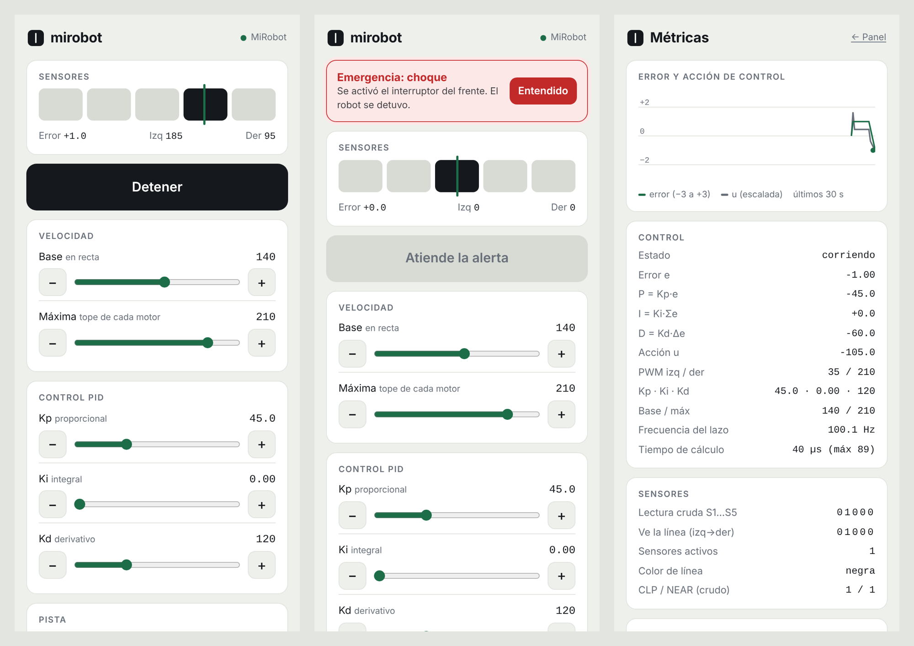
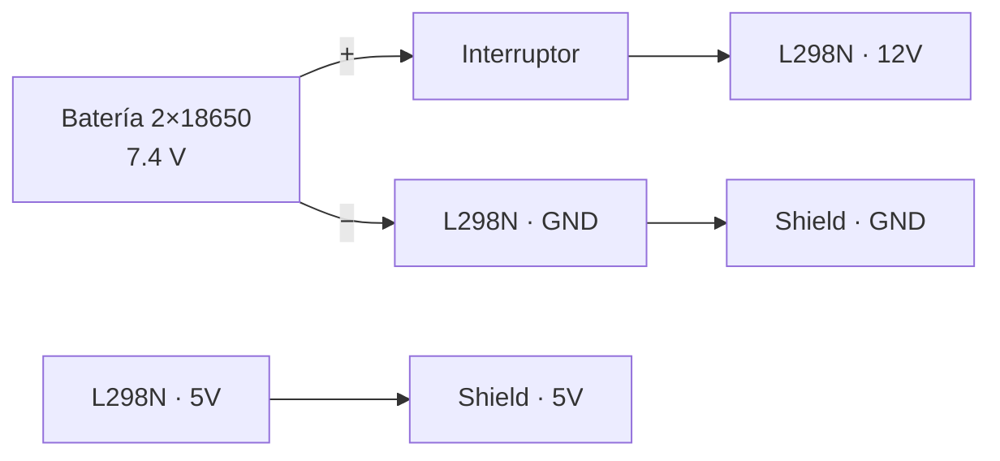
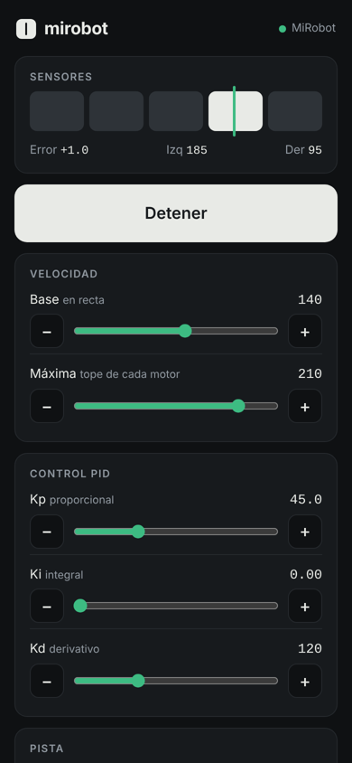

# Seguidor de línea ESP32

Robot seguidor de línea con **ESP32**, sensor **BFD-1000** de 5 canales, puente H **L298N** y control **PID**. Todo es configurable por constantes. Incluye un testbench para calibrar el robot por el Monitor Serie, y un panel web por WiFi para controlarlo y ajustar el PID desde el celular.



## Contenido

| Carpeta | Qué hay |
|---|---|
| [`firmware/testbench`](firmware/testbench) | **Calibración.** Asistente por el Monitor Serie que descubre qué motor es cuál, su sentido de giro y cómo leen los sensores. Imprime las constantes listas para copiar. |
| [`firmware/seguidor_pid`](firmware/seguidor_pid) | **Seguidor PID base.** Sin WiFi. Arranca y se detiene con el botón BOOT. |
| [`firmware/seguidor_web`](firmware/seguidor_web) | **Seguidor PID con panel web.** Red WiFi propia, `http://mirobot.com`, sliders del PID con memoria, alertas de choque y obstáculo, y página de métricas. |
| [`firmware/seguidor_wifi`](firmware/seguidor_wifi) | **Seguidor PID con panel web, cliente WiFi.** Se conecta a tu red (DHCP o IP fija) y el panel se abre en `http://<IP del robot>`. Sin DNS. |
| [`web`](web) | fuentes de la interfaz web y el script que la empaqueta en el firmware |
| [`hardware`](hardware) | chasis para corte láser, planos, modelo 3D y lista de componentes |
| [`docs`](docs) | guías detalladas y un [render de la interfaz](docs/ui_preview.html) con robot simulado |

```
seguidor-linea-esp32/
├── firmware/
│   ├── testbench/testbench.ino
│   ├── seguidor_pid/seguidor_pid.ino
│   ├── seguidor_web/
│   │   ├── seguidor_web.ino
│   │   └── web_ui.h            ← generado por web/build.py
│   └── seguidor_wifi/
│       ├── seguidor_wifi.ino
│       └── web_ui.h            ← generado por web/build.py
├── web/                        ← common.css, panel.html, metrics.html, build.py
├── hardware/
│   ├── README.md
│   └── chasis/                 ← SVG/DXF de corte, planos PDF, modelo 3D, fuente/
└── docs/
    ├── calibracion_y_pid.md
    ├── panel_web.md
    ├── ui_preview.html
    └── img/
```

## Hardware

| Componente | Cantidad |
|---|---|
| ESP32 DevKit 30 pines (CH340, USB-C) | 1 |
| Shield de expansión ESP32 30 pines (filas G/V/S, jumper 3.3V/5V) | 1 |
| Sensor de línea BFD-1000 | 1 |
| Puente H L298N | 1 |
| Motorreductor TT amarillo + rueda de 65 × 26 mm | 2 |
| Rueda loca giratoria de 25 mm | 1 |
| Portapilas 2×18650 + 2 baterías 18650 | 1 |
| Interruptor ON/OFF | 1 |
| Tabla de MDF de 3 mm (ver [hardware](hardware)) | 1 |

### Conexiones

**BFD-1000 → ESP32** (jumper **JUMP** de la shield en **3.3V**)

| BFD-1000 | VCC | GND | S1 (U1) | S2 (U2) | S3 (U4, centro) | S4 (U5) | S5 (U6) | CLP | Near |
|---|---|---|---|---|---|---|---|---|---|
| **ESP32** | V (3.3 V) | G | D21 | D19 | D18 | D17 | D16 | D22 | D23 |

**L298N → ESP32**

| L298N | ENA | IN1 | IN2 | ENB | IN3 | IN4 |
|---|---|---|---|---|---|---|
| **ESP32** | D25 | D26 | D27 | D14 | D33 | D13 |

**Alimentación**



- **Quita los jumpers ENA y ENB** del L298N; si no, no hay control de velocidad.
- Deja puesto el jumper de 5V del L298N.
- **La tierra debe ser común**: el GND del ESP32, el del L298N y el − de la batería unidos.
- El sensor va a **3.3 V**: a 5 V sus salidas superarían lo que aguantan los pines del ESP32.
- Desconecta el cable de 5V del L298N cuando programes por USB.
- No importa qué motor pongas en cada canal ni en qué sentido: eso lo resuelve el testbench.

## Puesta en marcha

### 1. Preparar Arduino IDE

1. Instala [Arduino IDE 2](https://www.arduino.cc/en/software).
2. En **Archivo → Preferencias → URLs adicionales**, agrega:
   ```
   https://espressif.github.io/arduino-esp32/package_esp32_index.json
   ```
3. En el **Gestor de tarjetas**, instala **esp32** de Espressif Systems.
4. Instala el driver **CH340** si Windows no reconoce la placa.
5. Selecciona **Herramientas → Placa → ESP32 Dev Module** y el puerto COM.

> Si al subir aparece `Wrong boot mode detected`, mantén presionado **BOOT** cuando la consola muestre `Connecting...`.

### 2. Calibrar con el testbench

1. Sube [`firmware/testbench`](firmware/testbench).
2. Abre el Monitor Serie a **115200 baudios** con **"Nueva línea"**.
3. Levanta el robot para que las ruedas giren en el aire.
4. Escribe `1` + Enter y sigue el asistente.
5. Copia el bloque de constantes que imprime al final.

### 3. Subir un seguidor

Pega las constantes en la sección **HARDWARE** de uno de los tres sketches:

| | `seguidor_pid` | `seguidor_web` / `seguidor_wifi` |
|---|---|---|
| Arrancar / detener | botón BOOT | panel web o botón BOOT |
| Ajustar el PID | editar el código y volver a subir | sliders en el celular, en vivo |
| Memoria de los valores | no (están en el código) | sí, en la flash, con protección anti-sobreescritura |
| Alertas CLP / NEAR | opcionales, solo detienen | detienen, avisan en el celular y bloquean el arranque |
| Métricas | Monitor Serie | página `/metrics` y JSON en `/api/metrics` |
| Red | — | `seguidor_web`: red propia del robot con DNS · `seguidor_wifi`: se une a tu red (DHCP o IP fija), sin DNS |

Con `seguidor_web`, conéctate a la red **MiRobot** (clave `robot1234`) y abre **`http://mirobot.com`** o `http://192.168.4.1`.

¿Prefieres que el robot se conecte a tu propia red WiFi? Usa **`seguidor_wifi`**: es igual a `seguidor_web`, pero en modo cliente. Pon el nombre y la clave de tu red, elige DHCP o IP fija, y abre `http://<IP>` (la IP se imprime en el Monitor Serie). Ver [docs/panel_web.md](docs/panel_web.md#9-modo-cliente-wifi-firmwareseguidor_wifi).

## Configuración

Cada sketch separa sus constantes en dos grupos:

- **Hardware** (cómo está armado *tu* robot, lo calcula el testbench): `BLACK_VALUE`, `S1_IS_LEFT`, `LEFT_CHANNEL`, `LEFT_INVERT`, `RIGHT_INVERT`, `CLP_ACTIVE_VALUE`, `NEAR_ACTIVE_VALUE`.
- **Lógica** (cómo se comporta): `LINE_COLOR` (línea negra o blanca), `BASE_SPEED`, `MAX_SPEED` (saturación), `KP`, `KI`, `KD`, tiempos y opciones de seguridad.

`seguidor_web` agrega la configuración de **red** (SSID, clave, IP, máscara /25, nombre DNS) y de **memoria** (tiempos de guardado). `seguidor_wifi` tiene la misma memoria, y en **red** pide la red a la que se conecta y si usa DHCP o IP fija (IP, puerta de enlace y máscara).

### Cómo funciona el PID

Cada sensor tiene un peso de −2 (izquierda) a +2 (derecha), y el error es el promedio de los pesos de los sensores que ven la línea. El control corre cada 10 ms:

```
u = Kp·e + Ki·Σe + Kd·Δe
rueda izquierda = BASE + u      rueda derecha = BASE − u      (saturadas a ±MAX)
```

Valores de partida: `Kp = 45`, `Ki = 0`, `Kd = 120`, `BASE = 140`, `MAX = 210`. El procedimiento de ajuste paso a paso está en [docs/calibracion_y_pid.md](docs/calibracion_y_pid.md#cómo-ajustar-el-pid).

## Panel web



- Red WiFi propia con DHCP en una red /25 y un solo cliente a la vez.
- DNS propio: `mirobot.com` apunta al robot.
- Variante **`seguidor_wifi`**: el robot se une a tu red WiFi (DHCP o IP fija) y el panel se abre por su IP, sin DNS.
- Botón de arrancar/detener, sliders de velocidad y PID con botones − / + para ajustes finos.
- Selector de línea negra o blanca.
- Alertas de **choque (CLP)** y **obstáculo (NEAR)** que detienen el robot, hacen vibrar el celular y bloquean el arranque hasta confirmarlas.
- Los valores se guardan en la flash solo 3 s después del último cambio y nunca más de una vez cada 10 s.
- `/metrics`: gráfico del error, términos P/I/D, PWM, sensores crudos, frecuencia del lazo, memoria y guardados.
- Sin dependencias externas: funciona sin internet. Modo claro y oscuro automático.

Detalles, API y problemas comunes en [docs/panel_web.md](docs/panel_web.md).

<br clear="right">

## Modificar la interfaz web

La interfaz vive en [`web/`](web). Después de editarla, regenera el archivo que usa el firmware:

```bash
python3 web/build.py
```

Esto actualiza el `web_ui.h` de `seguidor_web` y `seguidor_wifi`, y `docs/ui_preview.html`, un render con un robot simulado que puedes abrir en el navegador sin tener el ESP32.

## Documentación

- [Calibración y control PID](docs/calibracion_y_pid.md): testbench paso a paso, constantes, ajuste del PID y problemas comunes.
- [Panel web](docs/panel_web.md): red, DNS, memoria, métricas y API.
- [Hardware](hardware/README.md): chasis, alturas y componentes.
