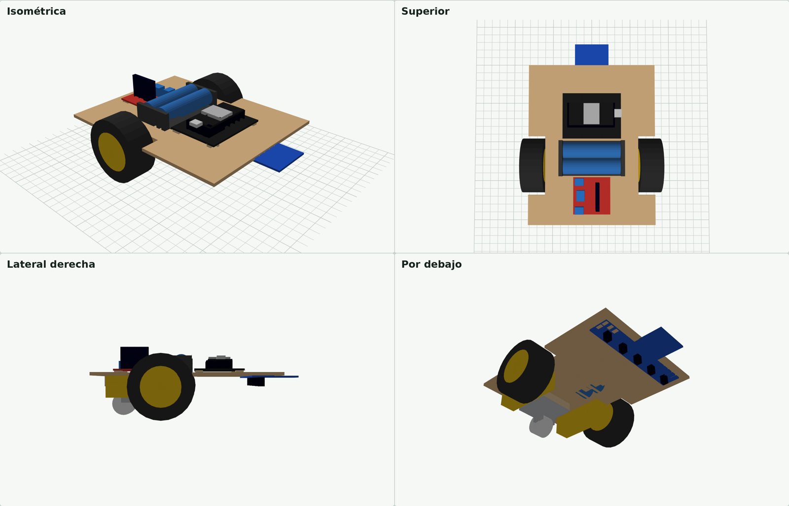

# Hardware



## Chasis

Es una sola tabla de **MDF de 3 mm, de 150 × 190 mm**, con recortes laterales para las ruedas. Todo se fija con pegamento y amarres plásticos; no lleva tornillos.

| Archivo | Para qué |
|---|---|
| [`chasis/chasis_corte_laser.svg`](chasis/chasis_corte_laser.svg) | archivo de corte. Rojo = cortar, azul = grabar (guía de posición). En mm. |
| [`chasis/chasis_corte_laser.dxf`](chasis/chasis_corte_laser.dxf) | lo mismo en DXF R12, con capas `CORTE` y `GRABADO` |
| [`chasis/chasis_planos.pdf`](chasis/chasis_planos.pdf) | 3 hojas a escala 1:1: tabla, cortes internos con coordenadas, vista lateral con alturas |
| [`chasis/chasis_3d.html`](chasis/chasis_3d.html) | modelo 3D interactivo (descárgalo y ábrelo en el navegador) |
| [`chasis/fuente/`](chasis/fuente) | scripts de Python que generan todo lo anterior |

En la misma lámina salen 3 separadores de 44 × 44 mm para la rueda loca y 8 separadores de 8 × 8 mm para las placas. La lámina mide 212 × 202 mm.

### Distribución

| Encima de la tabla | Debajo de la tabla |
|---|---|
| L298N (atrás) | 2 motores TT, al ras de los bordes |
| Portapilas 2×18650, sobre el eje de las ruedas | rueda loca giratoria (atrás) |
| ESP32 + shield (adelante) | sensor BFD-1000 (adelante), con una ventana en la tabla para ver sus LEDs |

### Alturas

| | Altura desde el piso |
|---|---|
| Eje de las ruedas (65 mm) | 32.5 mm |
| Cara inferior de la tabla | 43.75 mm |
| Rueda loca (34 mm) + 3 separadores de 3 mm | 43 mm |
| Sensores del BFD-1000 | ~32.75 mm |

### Antes de cortar

- **Agujeros de la rueda loca:** el diseño supone 34 mm entre centros. Mide los de tu rueda.
- **Altura del sensor:** el BFD-1000 queda cerca de su límite de lectura (el fabricante indica 30–40 mm). Si no distingue bien la línea, pega dos bloques de 15–20 mm entre la tabla y los extremos del sensor para bajarlo.
- Si cambias las ruedas, la tabla queda a `D/2 + 11.25` mm del piso, siendo `D` el diámetro.

### Regenerar los archivos

```bash
cd hardware/chasis/fuente
pip install matplotlib pillow
python3 lasergen.py      # SVG y DXF
python3 planos.py        # PDF de planos
python3 build_viewer.py  # modelo 3D
```

Todas las medidas están en `geom.py`. Los archivos se generan en `fuente/out/`.

## Componentes

| Componente | Medidas usadas en el diseño |
|---|---|
| ESP32 DevKit 30 pines (CH340, USB-C) + shield de expansión | 68.6 × 53.4 mm |
| Sensor BFD-1000 (5 sensores IR + CLP + Near) | 129 × 56 × 11 mm |
| Puente H L298N | 43 × 43 × 27 mm |
| 2 motorreductores TT amarillos | 70 × 19 × 22.5 mm, eje a 11.5 mm del extremo |
| 2 ruedas | Ø65 × 26 mm |
| Rueda loca giratoria | rueda Ø25, alto 34 mm, placa 44 × 44 mm |
| Portapilas 2×18650 | 76 × 41.1 × 18.3 mm |
